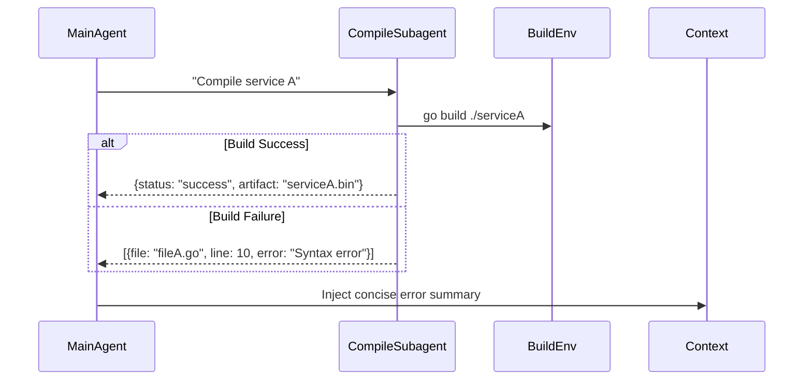

## Problem

Large coding tasks often involve multiple independent components (e.g., microservices, libraries). Having the **main agent** handle compilation and error checking for every component in-context:

- **Blows Up Context Length:** Including entire build logs or bytecode in the prompt is impractical.
- **Slows Down Inference:** Sending full build commands and parsing verbose output in-context uses excessive tokens.

Additionally, when the agent's single "compile-and-run" step fails, it's hard to pinpoint which submodule caused the error without a more granular approach.

## Solution

Spawn **specialized "Compilation Subagents"** to independently build and verify each code submodule, reporting back only:

**1. Error Summary:** File paths, line numbers, and error messages.
**2. Binary Artifacts (if needed):** Reference IDs (e.g., paths to compiled object files) rather than raw binaries.

**Workflow:**
- **Main Agent Request:** "Compile module `auth-service`."
- **Spawn `CompileSubagent(auth-service)`**
  - Subagent runs `mvn clean install` or `go build ./auth-service`.
  - Returns a structured error list or location of compiled artifact.
- **Main Agent:** Updates its context with the **concise error report** (e.g., `[{file: "auth_controller.go", line: 85, error: "undefined: UserModel"}]`).

## Evidence

- **Evidence Grade:** `medium`
- **Most Valuable Findings:**
  - Will Brown's talk motivates decoupling long I/O-bound build steps from the main model's inference to avoid context explosion
  - Self-Refine (Madaan et al., 2023) supports the value of iterative feedback loops, without quantified gains for this use case
  - CaMeL (Debenedetti et al., 2025) demonstrates verification before execution as a safety pattern
  - Claude Code documents first-party subagents that read files and run tools in their own context window, returning only findings
- **Unverified / Unclear:** Quantitative impact on main agent context efficiency; optimal subagent parallelization strategies

## Example

## How to use it

- **Subagent Definition:** Each subagent is a lightweight container or process with the appropriate runtime (e.g., JVM for Java code, Node for JavaScript).
- **Integration in RL Loop:** Treat each subagent invocation as a **tool call** within the RL environment.
- **Error-Driven Reward:** If the error list is non-empty, assign a negative reward proportional to the number of errors (e.g., `reward = −len(error_list)`), to encourage the agent to fix compile errors quickly.

## Trade-offs

- **Pros:**
  - **Modular Isolation:** The main agent never needs to load entire build logs into its context.
  - **Parallel Builds:** Multiple subagents can compile different modules in parallel, speeding up end-to-end workflow.
- **Cons/Considerations:**
  - **Infrastructure Overhead:** Requires a mechanism to spin up and tear down multiple build environments.
  - **Subagent Synchronization:** If one module depends on another's build artifact, coordination policies must ensure the correct build order.

## References

- Inspired by subagent spawning for code-related subtasks in Will Brown's Open Source Agent RL talk (May 2025). The talk motivates the pattern but does not verifiably describe this compilation-checker variant in detail.
- Will Brown's note on decoupling long I/O-bound steps from the main model's inference to avoid context explosion.
- Madaan, A., et al. (2023). "Self-Refine: Iterative Refinement with Self-Feedback." *arXiv:2303.17651* (ICLR 2024)
- Debenedetti, E., et al. (2025). "CaMeL: Defeating Prompt Injections by Design." *arXiv:2503.18813* (Google DeepMind)
- Beurer-Kellner, L., et al. (2025). "Design Patterns for Securing LLM Agents against Prompt Injections." *arXiv:2506.08837*
- [Claude Code subagents documentation](https://code.claude.com/docs/en/sub-agents) - first-party subagent mechanism with per-subagent context and tool scoping
- Distinct from [Sub-Agent Spawning](sub-agent-spawning.md): that pattern covers general-purpose delegation to subagents, while this pattern specializes subagents for build and compile verification with structured error reports
- Primary source: https://www.youtube.com/watch?v=Xkwok_XXQgw
