## Problem

Complex AI agents often struggle with unstructured inputs and need a systematic way to process information before taking action. Without a clear separation of concerns, agents can become monolithic and difficult to debug, extend, or optimize. Additionally, mixing perception, processing, and action logic makes it hard to swap out components or scale different parts of the system independently.

## Solution

Implement a three-stage pipeline architecture that cleanly separates an agent's workflow into distinct phases:

1. **Perception Stage**: Handles all input gathering and normalization
   - Receives raw inputs (text, images, audio, structured data)
   - Performs initial processing (OCR, speech-to-text, format conversion)
   - Normalizes data into a common internal representation

2. **Processing Stage**: Performs reasoning and decision-making
   - Analyzes normalized inputs using appropriate models
   - Applies business logic and reasoning
   - Makes decisions about what actions to take
   - Can involve multiple sub-agents or reasoning steps

3. **Action Stage**: Executes decisions in the environment
   - Translates decisions into concrete actions
   - Interfaces with external systems and APIs
   - Handles error recovery and retries
   - Reports results back to the system

## Evidence

- **Robotics and cognitive-science lineage:** the sense-plan-act control cycle and Newell and Simon's information-processing theory date back decades. Brooks (1986) critiqued strict staging in favor of layered control — the trade-off between staged pipelines and interleaved loops is old and still live.
- **Modern surveys:** a 2026 agent-systems survey (arXiv:2601.01743) documents modular separation of perception, planning, and execution throughout current agent stacks — multimodal agents decompose perception into tools such as OCR, detection, and layout parsing, with an LLM planner integrating the results.
- **Practitioner guides:** a 2026 MLflow developer guide states that effective agents "separate perception, reasoning, planning, memory, tool use, and oversight into explicit architectural layers," and identifies monolithic designs as the main maintainability failure mode.
- **Multimodal absorption:** current multimodal models accept images and audio natively, so parts of the perception stage (OCR, speech-to-text, format conversion) increasingly move into the model itself. The stage shrinks but does not disappear — normalization and schema validation remain.

## Example

```python
class ThreeStageAgent:
    def __init__(self):
        self.perception = PerceptionPipeline()
        self.processor = ProcessingPipeline()
        self.action = ActionPipeline()
    
    async def run(self, raw_input):
        # Stage 1: Perception
        perceived_data = await self.perception.process(raw_input)
        
        # Stage 2: Processing
        decisions = await self.processor.analyze(perceived_data)
        
        # Stage 3: Action
        results = await self.action.execute(decisions)
        
        return results

class PerceptionPipeline:
    def __init__(self):
        self.handlers = {
            'text': TextHandler(),
            'image': ImageHandler(),
            'audio': AudioHandler(),
            'structured': StructuredDataHandler()
        }
    
    async def process(self, raw_input):
        input_type = self.detect_input_type(raw_input)
        handler = self.handlers[input_type]
        
        # Normalize to common format
        normalized = await handler.normalize(raw_input)
        
        # Extract features
        features = await handler.extract_features(normalized)
        
        return {
            'type': input_type,
            'normalized': normalized,
            'features': features,
            'metadata': handler.get_metadata(raw_input)
        }

class ProcessingPipeline:
    def __init__(self):
        self.reasoning_engine = ReasoningEngine()
        self.decision_maker = DecisionMaker()
    
    async def analyze(self, perceived_data):
        # Apply reasoning based on input type and features
        analysis = await self.reasoning_engine.reason(perceived_data)
        
        # Make decisions based on analysis
        decisions = await self.decision_maker.decide(
            analysis,
            context=self.get_context()
        )
        
        # Validate decisions
        validated = await self.validate_decisions(decisions)
        
        return validated

class ActionPipeline:
    def __init__(self):
        self.executors = {
            'api_call': APIExecutor(),
            'database': DatabaseExecutor(),
            'file_system': FileSystemExecutor(),
            'notification': NotificationExecutor()
        }
    
    async def execute(self, decisions):
        results = []
        
        for decision in decisions:
            executor = self.executors[decision.action_type]
            
            try:
                result = await executor.execute(decision)
                results.append({
                    'decision': decision,
                    'status': 'success',
                    'result': result
                })
            except Exception as e:
                # Handle errors gracefully
                recovery_result = await self.attempt_recovery(decision, e)
                results.append(recovery_result)
        
        return results
```

```mermaid
flowchart LR
    subgraph "Perception Stage"
        A[Raw Input] --> B[Type Detection]
        B --> C[Normalization]
        C --> D[Feature Extraction]
        D --> E[Structured Data]
    end
    
    subgraph "Processing Stage"
        E --> F[Reasoning Engine]
        F --> G[Analysis]
        G --> H[Decision Making]
        H --> I[Validation]
        I --> J[Action Plan]
    end
    
    subgraph "Action Stage"
        J --> K[Executor Selection]
        K --> L[Action Execution]
        L --> M[Error Handling]
        M --> N[Results]
    end
    
    N --> O[Feedback Loop]
    O --> F
    
    style A fill:#ffebee,stroke:#c62828,stroke-width:2px
    style J fill:#e8f5e9,stroke:#2e7d32,stroke-width:2px
    style N fill:#e3f2fd,stroke:#1565c0,stroke-width:2px
```



## Benefits

- **Modularity**: Each stage can be developed, tested, and scaled independently
- **Flexibility**: Easy to swap implementations for different stages
- **Debugging**: Clear boundaries make it easier to identify where issues occur
- **Reusability**: Stages can be shared across different agent types
- **Scalability**: Different stages can be scaled based on their computational needs

## Trade-offs

**Pros:**
- Clean separation of concerns
- Easier to maintain and extend
- Better error isolation
- Enables specialized optimization per stage
- Facilitates team collaboration (different teams per stage)

**Cons:**
- Additional complexity for simple tasks
- Potential latency from stage transitions
- Requires careful interface design between stages
- May introduce overhead for data transformation between stages

## How to use it

- Use when input handling, reasoning, and execution have different scaling needs, failure modes, or owning teams; the stage boundaries make each one independently testable.
- Define typed interfaces between stages so each stage can be replaced without touching the others.
- Let native multimodal input handle perception where the model already accepts the modality; keep only normalization and schema validation as explicit perception steps.
- Distinct from [discrete-phase-separation.md](discrete-phase-separation.md): that pattern splits work into separate conversations (research, planning, implementation) with fresh context each; this pattern splits the runtime pipeline of a single agent run into perception, processing, and action stages.

## References

- Xu, B. (2026). "AI Agent Systems: Architectures, Applications, and Evaluation." [arXiv:2601.01743](https://arxiv.org/abs/2601.01743) — survey documenting modular separation of perception, planning, and execution in current agent stacks; the source for this pattern's modern framing.
- [Types of AI Agent Architectures: 2026 Developer Guide (MLflow)](https://mlflow.org/articles/types-of-ai-agent-architectures-2026-developer-guide/) — practitioner guide recommending explicit architectural layers for perception, reasoning, planning, and oversight in production agents.
- Yao, S., et al. (2022). "ReAct: Synergizing Reasoning and Acting in Language Models." [arXiv:2210.03629](https://arxiv.org/abs/2210.03629) — contrasting related work: ReAct interleaves reasoning and action in a single loop rather than separating them into pipeline stages.
- Schick, T., et al. (2023). "ToolFormer: Language Models Can Teach Themselves to Use Tools." [arXiv:2302.04761](https://arxiv.org/abs/2302.04761)
- Newell, A., & Simon, H. A. (1972). "Human Problem Solving." Prentice-Hall
- Brooks, R. A. (1986). "A robust layered control system for a mobile robot." IEEE Journal of Robotics and Automation
- [Software Architecture Patterns](https://www.oreilly.com/library/view/software-architecture-patterns/9781491971437/)
