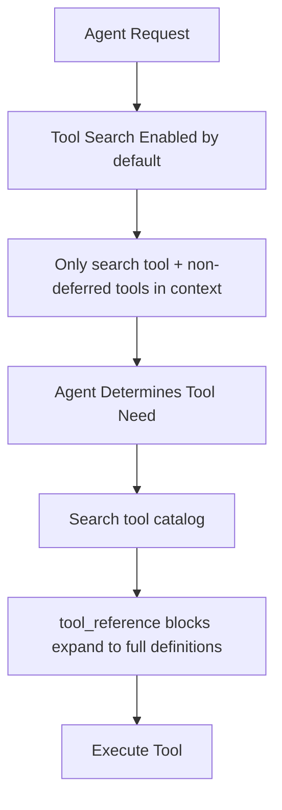

## Problem

As the Model Context Protocol (MCP) has grown, MCP servers may expose 50+ tools that consume significant context space. Setups with 7+ servers were reported consuming 67k+ tokens just for tool descriptions at the feature's launch announcement. This creates a fundamental scalability issue:

* **Context bloat**: Preloading all tool descriptions consumes tokens that could be used for the actual task
* **Latency**: More tools means more processing overhead on every request
* **Discovery challenges**: Agents must scan through many irrelevant tools to find relevant ones
* **Memory pressure**: Large tool catalogs can exceed practical context limits

## Solution

Implement Tool Search: a lazy-loading mechanism where tools are dynamically loaded into context via search only when needed, rather than preloaded on initialization.

Tool search is now default behavior rather than an opt-in optimization:

1. **On by default in Claude Code**: a `ToolSearch` tool loads tool definitions on demand; `ENABLE_TOOL_SEARCH=false` (or a custom `ANTHROPIC_BASE_URL`, or a pre-4.5-generation model on Google Cloud's Agent Platform) disables it, and without tool search Claude Code falls back to a `WaitForMcpServers` tool. The current MCP documentation states no activation threshold — the 10%-of-context threshold described at launch (January 2026) is no longer a documented gate.
2. **First-party API support**: the Claude API ships a server-side tool search tool in two variants, `tool_search_tool_regex_20251119` (Claude writes Python regex patterns) and `tool_search_tool_bm25_20251119` (natural language queries). You still send every tool definition in the `tools` array, mark deferred ones with `defer_loading: true`, and the API returns `tool_reference` blocks that it expands into full definitions — up to 10,000 deferred tools per request, with the system prompt prefix untouched so prompt caching is preserved.
3. **Server instructions**: MCP server instruction fields guide the agent on when to search for specific tools.
4. **Agentic search**: use search over tool names, descriptions, argument names, and argument descriptions rather than a fixed embedding index.



**Implementation approach (Claude API):**

```pseudo
function build_tools(all_tools) {
    tools = [tool_search_tool_regex]          // never deferred
    for tool in frequently_used(all_tools, n=3..5):
        tools.push(tool)                       // stay non-deferred
    for tool in rest(all_tools):
        tools.push(tool with defer_loading=true)
    return tools                              // API searches server-side
}

function tool_search_result(response) {
    // keep server_tool_use and tool_search_tool_result blocks in history;
    // the API expands tool_reference blocks for Claude
}
```

## How to use it

**For MCP server creators:**

* **Enhance server instructions**: The "server instructions" field becomes more critical with tool search enabled. It helps the agent know when to search for your tools.
* **Descriptive metadata**: Include rich descriptions and tags to improve searchability
* **Logical grouping**: Organize related tools to make discovery more intuitive

**For MCP client creators:**

* **Implement ToolSearchTool**: Provide a search interface for tool discovery
* **Use agentic search**: Implement intelligent search rather than basic vector RAG
* **Follow the documented enablement guidance**: enable tool search at 10+ tools, when definitions exceed 10k tokens, or when aggregating 200+ tools across MCP servers; standard tool calling is a better fit below 10 tools or under 100 tokens of definitions
* **Provide opt-out**: Allow users to disable search if they prefer preloading (Claude Code exposes `ENABLE_TOOL_SEARCH=false`)

**Usage scenarios:**

* Development environments with many specialized tools (file operations, git, database access, API clients)
* Multi-server setups where each server provides domain-specific capabilities
* Agents that only need a subset of available tools for any given task

## Trade-offs

* **Pros:**
  * Dramatically reduces baseline context usage: the API docs report a typical GitHub/Slack/Sentry/Grafana/Splunk multiserver setup consuming ~55k tokens in definitions, which tool search typically reduces by over 85% by loading only the 3-5 tools a request needs
  * Enables scaling to thousands of deferred tools without context issues
  * Keeps tool selection accuracy high past the 30-50 tool range where it normally degrades
  * Preserves prompt caching, because deferred tools are excluded from the system-prompt prefix
  * Allows more MCP servers to be enabled simultaneously

* **Cons:**
  * Adds latency when tools need to be dynamically loaded
  * Requires search infrastructure and metadata management
  * May miss serendipitous tool discovery that happens when browsing full catalogs
  * Server instructions become more critical and require careful authoring
  * Additional complexity in client implementation

## References

* [Original announcement tweet](https://x.com/trq212/status/2011523109871108570) by Thariq (@trq212), January 14, 2026 — reported 67k+ token setups and a 10% context threshold at launch
* Claude Code MCP documentation (tool search on by default, `ENABLE_TOOL_SEARCH`, `WaitForMcpServers` fallback; no activation threshold stated): https://code.claude.com/docs/en/mcp
* Claude API tool search tool (`tool_search_tool_regex_20251119` / `tool_search_tool_bm25_20251119`, `defer_loading`, `tool_reference` expansion, 10,000 deferred tools, >85% reduction, enablement guidance): https://platform.claude.com/docs/en/agents-and-tools/tool-use/tool-search-tool
* Managing tool context (positions tool search as the standard answer for 20+ tool sets): https://platform.claude.com/docs/en/agents-and-tools/tool-use/manage-tool-context
* MCP specification changelog (no `tools/search` primitive added through the 2025-11-25 spec, so client-side tool search remains the practice): https://modelcontextprotocol.io/specification/2025-11-25/changelog
* Distinct from [Progressive Tool Discovery](progressive-tool-discovery.md): that pattern covers server-side techniques for exposing and paginating tool detail, while this one is the client- and API-side decision to search a catalog instead of preloading definitions

## Variations

**Toggle-based forcing**: Allow users to force tool search on or off explicitly (`ENABLE_TOOL_SEARCH` in Claude Code), for consistency or testing purposes, instead of relying on defaults.

**Caching strategies**: Implement LRU caching for recently used tools to minimize reload overhead.

**Progressive loading**: Load commonly-used tools upfront while keeping long-tail tools in search-only mode.

**Programmatic composition**: Future direction allowing tools to be composed with each other via code (experimented with but deferred for tool search priority).

## Pitfalls

* **Poor server instructions**: Without clear guidance on when to search, agents may miss relevant tools
* **Inadequate search**: Basic RAG may not capture tool capabilities effectively; agentic search is preferred
* **Metadata neglect**: Failing to maintain rich, searchable tool descriptions defeats the purpose
* **Deferring the wrong tools**: deferring every tool (including the search tool itself) is rejected; deferring your most frequently used tools forces a search before every call
