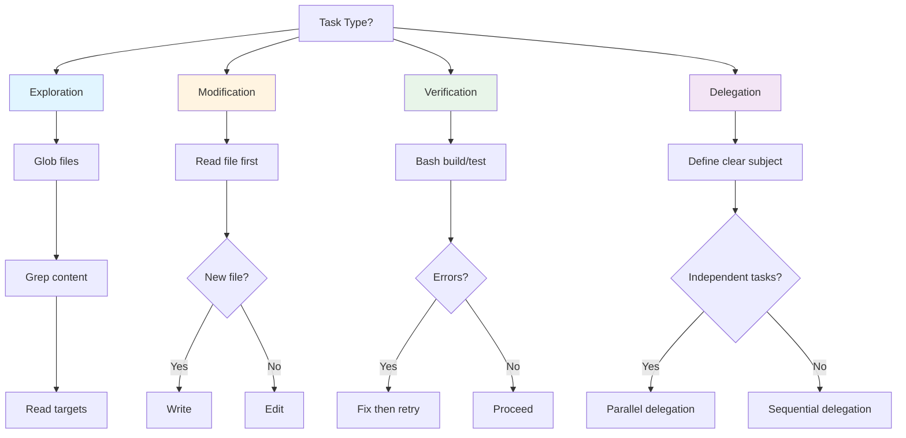

## Problem

AI agents often struggle to select the optimal tool for a given task, leading to inefficient workflows. Common anti-patterns include:

- Using `Write` when `Edit` would be more appropriate
- Launching subagents for simple exploration tasks
- Skipping build verification after code changes
- Performing sequential exploration when parallel would be faster

These inefficiencies compound across long sessions, resulting in wasted tokens, slower completion, and more user corrections.

## Solution

Encode tool selection patterns that emerged from the author's analysis of 88 real-world Claude conversation sessions and that align with Anthropic's published Claude Code guidance (read files before editing, verify changes with shell commands). By matching task type to the right tool, agents can follow proven workflows.

**Tool preference patterns from observed usage** (session counts come from the author's analysis, whose repository is no longer online — treat them as illustrative, not reproducible):

| Task Type | Recommended Tool | Evidence |
|-----------|-----------------|----------|
| Codebase exploration | Read → Grep → Glob | Consistent pattern across all analyzed projects |
| Code modification | Edit (not Write) | Edits far outnumbered Writes in the analyzed sessions |
| New file creation | Write | Appropriate use case |
| Build verification | Bash | The most frequently used tool in the analyzed sessions |
| Research delegation | Task (with clear subject) | Used repeatedly, always with a subject |

**Key selection criteria:**

1. **Exploration tasks** (discovering code structure, finding patterns):
   - Start with `Glob` for file discovery
   - Use `Grep` for content search (syntax-aware when available)
   - Use `Read` for targeted file inspection

2. **Code modification tasks** (changing existing code):
   - **Prefer `Edit` over `Write`** - preserves existing context and comments, and a partial diff costs far fewer tokens than a full file rewrite
   - Only use `Write` for brand new files or complete rewrites (with permission)
   - Use `Write` when changing >50% of a file; otherwise use `Edit`
   - Always `Read` the file before editing

3. **Verification tasks** (testing, building, checking):
   - Use `Bash` for build commands, test runners, and linting
   - Run verification **after** every Edit/Write operation
   - Check for errors/warnings before proceeding

4. **Delegation tasks** (parallel exploration):
   - Use `Task` tool for subagent delegation
   - **Always provide clear task subjects** (no empty strings)
   - Prefer parallel over sequential for independent exploration
   - Parallel delegation can provide order-of-magnitude speedups for independent tasks (e.g., framework migrations), per the original session analysis

## How to use it

**Before using any tool**, mentally categorize the task:

- "Am I discovering something?" → Exploration toolkit
- "Am I changing something?" → Edit (after Read)
- "Am I checking something?" → Bash verification
- "Am I delegating something?" → Task with clear subject

**Anti-pattern prevention:**

- Don't use `Write` for modifications (use `Edit`)
- Don't skip `Read` before `Edit`
- Don't claim work complete without `Bash` verification
- Don't use empty task subjects in `Task` invocations
- Don't explore sequentially when parallel is possible

## Trade-offs

**Pros:**

- Grounded in observed sessions and consistent with Anthropic's published guidance
- Reduces token waste and user corrections
- Faster workflow completion
- Clear mental model for tool selection
- Prevents common anti-patterns

**Cons:**

- Requires tool availability (e.g., Bash for verification)
- Parallel delegation increases cost
- May feel slower for simple one-off tasks
- Requires discipline to follow patterns consistently

## References

* [Claude Code: Best Practices for Agentic Coding](https://www.anthropic.com/engineering/claude-code-best-practices) (Anthropic) — published guidance that matches the core rules: explore before editing, read files before changes, and verify work with shell commands (live replacement for the original analysis)
* Original evidence base: the author's 88-session Claude analysis (`github.com/nibzard/SKILLS-AGENTIC-LESSONS`) is no longer available (HTTP 404), so the per-project counts cited above cannot be independently reproduced
* Related patterns: [Sub-Agent Spawning](sub-agent-spawning.md), [Discrete Phase Separation](discrete-phase-separation.md), [Subject Hygiene](subject-hygiene.md)
* ToolFormer: [Language Models Can Teach Themselves to Use Tools](https://arxiv.org/abs/2302.04761) (Schick et al., 2023)
* ReAct: [Synergizing Reasoning and Acting in Language Models](https://arxiv.org/abs/2210.03629) (Yao et al., 2022)
