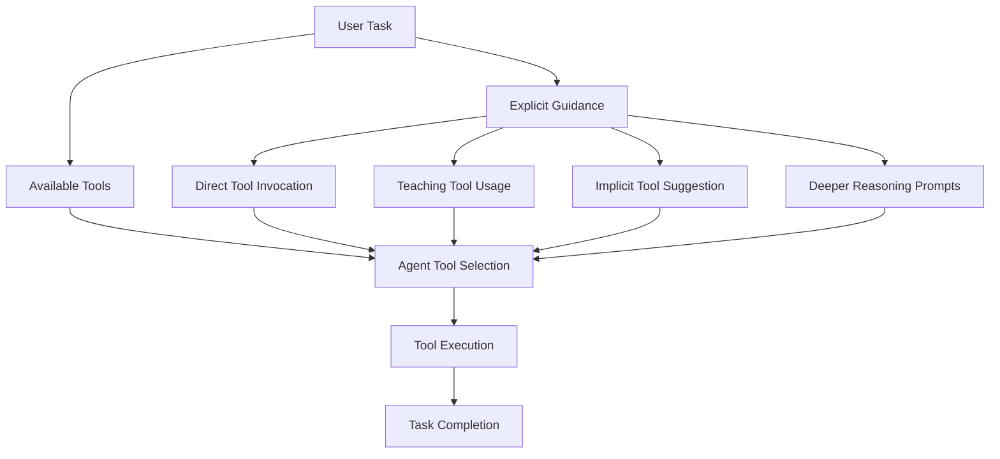

## Problem

AI agents equipped with multiple tools (e.g., shell access, file system operations, web search, custom CLIs) need clear guidance on when, why, and how to use these tools effectively. Simply having tools available doesn't guarantee they will be used appropriately for the task at hand, especially for tools unfamiliar to the base model or specific to a team's workflow.

## Solution

Guide the agent's tool selection and execution through explicit natural language instructions within the prompt. This includes:

-   **Direct Tool Invocation:** Telling the agent which tool to use for a specific part of a task (e.g., "Use the file search tool to find...", "Run a bash command to...").
-   **Teaching Tool Usage:** Instructing the agent on how to learn about or use a new or custom tool, including how to discover its options (e.g., "Use our `barley` CLI to check logs. You can use `-h` to see how to use it.").
-   **Implicit Tool Suggestion:** Using phrases or shorthands that the agent learns to associate with specific tool sequences (e.g., "commit, push, pr" for a Git workflow).
-   **Encouraging Deeper Reasoning for Tool Use:** Adding phrases like "*think hard*" to prompt more careful consideration before acting, potentially leading to better tool choices or sequences.

This pattern emphasizes the user's role in actively shaping the agent's behavior with respect to its available tools, rather than relying solely on autonomous tool selection.

The technique is grounded in research showing that interleaving reasoning traces with action execution—where the model explicitly thinks about which tool to use before acting—improves outcomes (Yao et al., 2022, ReAct).

Distinct from [Patch Steering via Prompted Tool Selection](patch-steering-via-prompted-tool-selection.md), which applies the same steering idea specifically to choosing among patching or refactoring tools with per-tool usage rules and a fallback order.

## Evidence

- **Evidence Grade:** `medium`
- **ReAct (Yao et al., ICLR 2023)**: interleaving reasoning traces with actions beats imitation and reinforcement learning baselines by an absolute success rate of 34% on ALFWorld and 10% on WebShop
- **Practitioner report:** Boris Cherny recommends teaching the agent your team's tools and steering tool choice in prompts (Claude Code interview, see References)
- **Community discussion:** the technique is reported to work, and is debated as a named pattern: https://news.ycombinator.com/item?id=46491244

## Example (tool guidance flow)

## How to use it

- Use when agent success depends on reliable tool invocation, especially with custom or team-specific tools the base model does not know
- Structure guidance hierarchically: task categorization first, then tool selection rules
- Include decision frameworks (e.g., "if modifying existing code, use Edit; if creating new file, use Write")
- Add verification gates: always run build/test after code changes to prevent error cascades

## Trade-offs

* **Pros:** Improves execution success, reduces tool-call failures, and favors surgical edits over rewriting whole files, which keeps more of the conversation cacheable
* **Cons:** Introduces integration coupling, requires prompt maintenance as tool interfaces evolve, and spends prompt tokens on guidance in every session

## References

- Boris Cherny on steering Claude toward specific tools and teaching it team-specific CLIs: [How to Use Claude Code Like the People Who Built It](https://every.to/podcast/transcript-how-to-use-claude-code-like-the-people-who-built-it)
- Secondary summary of the same material: [Mastering Claude Code: Boris Cherny's Guide & Cheatsheet](https://www.nibzard.com/claude-code)
- Yao, S., et al. (2022). [ReAct: Synergizing Reasoning and Acting in Language Models](https://arxiv.org/abs/2210.03629) (ICLR 2023) — reports absolute success-rate gains of 34% (ALFWorld) and 10% (WebShop) over imitation and reinforcement learning baselines
- Community discussion of the technique: [Hacker News](https://news.ycombinator.com/item?id=46491244)
