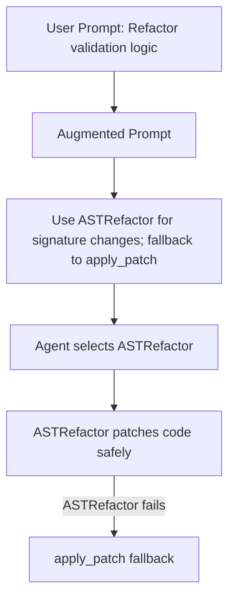

## Problem

AI agents equipped with multiple tools (shell access, file system operations, web search, custom CLIs, several patching tools) need clear guidance on when, why, and how to use them. Simply having tools available does not guarantee they will be used appropriately, especially for tools unfamiliar to the base model or specific to a team's workflow. Common anti-patterns:

- Using `Write` for a small change when `Edit` would preserve context and comments
- Running `sed` or heredocs through `Bash` for file modification instead of a structured edit tool
- Launching subagents for simple exploration, or exploring sequentially when parallel would be faster
- Picking a generic text-replace tool for a refactor that needs an AST-aware one, breaking imports or references
- Skipping build verification after code changes, so errors cascade
- Tool selection varies between runs for the same task

These inefficiencies compound across long sessions, resulting in wasted tokens, slower completion, and more user corrections.

## Solution

Guide the agent's tool selection and execution through explicit natural language instructions in the prompt. The user actively shapes the agent's behavior toward its available tools rather than relying solely on autonomous selection. The technique is grounded in research showing that interleaving reasoning traces with action execution, where the model explicitly thinks about which tool to use before acting, improves outcomes (Yao et al., 2022, ReAct).

Three concrete levers cover most cases.

### Lever 1: Task-to-tool routing table

Map each task type to a preferred tool so the agent follows a proven workflow instead of guessing. These rules align with Anthropic's published Claude Code guidance (read files before editing, verify changes with shell commands).

| Task Type | Preferred Tool | Rule |
|-----------|----------------|------|
| Codebase exploration | `Glob` → `Grep` → `Read` | Not `Bash`; discover files, search content, then read targets |
| Code modification | `Edit` | Not `Write`, and not shell `sed`/heredocs; preserves context and comments, and a partial diff costs far fewer tokens than a full rewrite |
| New file or complete rewrite | `Write` | Only for brand new files, or when changing more than half the file |
| Build and test verification | `Bash` | Run after every edit; check for errors before proceeding |
| Broad multi-step work | Subagent with a clear subject | Parallel over sequential for independent exploration; never an empty subject |

**Key selection criteria:**

1. **Exploration** (discovering structure, finding patterns): start with `Glob` for file discovery, use `Grep` for content search (syntax-aware when available), use `Read` for targeted inspection.
2. **Modification** (changing existing code): always `Read` the file before editing, then `Edit`.
3. **Verification** (testing, building, checking): use `Bash` for build commands, test runners, and linting; run it after every `Edit`/`Write` operation.
4. **Delegation** (parallel exploration): use the subagent tool with a clear, non-empty subject; prefer parallel for independent tasks.

**Anti-pattern prevention:** don't use `Write` for modifications; don't skip `Read` before `Edit`; don't claim work complete without `Bash` verification; don't use empty subagent subjects; don't explore sequentially when parallel is possible.

### Lever 2: Edit and patch tool steering

When the agent has several patching tools (text search/replace, AST-aware refactoring, semantic migration) or when the edit *format* itself is the variable, name the tool and the format explicitly.

**Name the tool and the format:**

- "Use the `apply_patch` tool to insert a new function `validate_input` in `auth_service.py`."
- "Return a unified diff, one hunk per function."

**Teach the tool in the prompt** with a mini-manual:

```text
"Our `ASTRefactor` tool takes JSON describing node edits:
{"file": string, "pattern": string, "replacement": string}.
Use it for safe refactors rather than raw sed commands."
```

**Prefer familiar, forgiving formats.** Aider's benchmarks found that simple, familiar formats (unified diffs) beat structured formats such as JSON tool calls for code edits, because escaping code is error-prone, and that flexibly applying imperfect patches mattered: strict application increased editing errors about 9x.

**Negative constraints and fallback order:**

- Specify what NOT to use: "Do NOT use text-based patching for signature changes (it breaks imports)."
- Specify a fallback chain, semantic → AST → text, for when the safer tool fails, and test the chain.



### Lever 3: Custom tool discovery and shorthand macros

- **Teaching tool usage:** instruct the agent on how to learn a new or custom tool, including how to discover its options (for example, "Use our `barley` CLI to check logs. You can use `-h` to see how to use it.").
- **Implicit tool suggestion:** use shorthands the agent learns to associate with tool sequences, such as "commit, push, pr" for a Git workflow.
- **Encouraging deeper reasoning:** phrases like "*think hard*" prompt more careful consideration before acting, which can lead to better tool choices.

## Evidence

- **Evidence Grade:** `medium`
- **ReAct (Yao et al., ICLR 2023)**: interleaving reasoning traces with actions beats imitation and reinforcement learning baselines by an absolute success rate of 34% on ALFWorld and 10% on WebShop
- **Aider refactoring benchmark**: prompting GPT-4 Turbo to emit unified diffs instead of the previous search/replace block format raised the score from 20% to 61%, and lazy "rest of code unchanged" edits dropped from 12 of 89 tasks to 4
- **Practitioner report:** Boris Cherny recommends teaching the agent your team's tools and steering tool choice in prompts (Claude Code interview, see References)
- **Community discussion:** the technique is reported to work, and is debated as a named pattern (see References)

## How to use it

- Use when agent success depends on reliable tool invocation, especially with custom or team-specific tools the base model does not know.
- Structure guidance hierarchically: task categorization first, then tool selection rules.
- Include decision frameworks (for example, "if modifying existing code, use `Edit`; if creating a new file, use `Write`").
- Add verification gates: always run build/test after code changes to prevent error cascades.
- Expose tool metadata (name, usage example, input schema, capabilities and limits) in the agent's initialization context, with `use_when` and `avoid_when` criteria per tool.
- Reuse prompt templates with placeholders, for example `"Task: {task_description}. Preferred tool: {tool_name}. Usage example: {tool_usage_snippet}."`

## Trade-offs

**Pros:**

- Improves execution success and reduces tool-call failures
- Reduces variance in tool usage for the same task and steers the agent to semantically safe tools and formats
- Favors surgical edits over whole-file rewrites, which keeps more of the conversation cacheable and reduces token waste
- Edit-format steering shows large benchmark deltas (aider: 20% to 61% on GPT-4 Turbo)
- Clear mental model for tool selection; prevents common anti-patterns

**Cons:**

- Introduces integration coupling and requires prompt maintenance as tool interfaces evolve
- Spends prompt tokens on guidance in every session; tool documentation consumes tokens
- Format lock-in: a format chosen for one model may not be optimal for the next; re-run benchmarks when the model changes
- Requires the tools to be available (for example, `Bash` for verification); parallel delegation increases cost
- May feel slower for simple one-off tasks

## References

- Boris Cherny on steering Claude toward specific tools and teaching it team-specific CLIs: [How to Use Claude Code Like the People Who Built It](https://every.to/podcast/transcript-how-to-use-claude-code-like-the-people-who-built-it)
- Secondary summary of the same material: [Mastering Claude Code: Boris Cherny's Guide & Cheatsheet](https://www.nibzard.com/claude-code)
- Anthropic: [Claude Code: Best Practices for Agentic Coding](https://www.anthropic.com/engineering/claude-code-best-practices) - published guidance that matches the routing rules: explore before editing, read files before changes, verify work with shell commands
- Aider: [Unified diffs make GPT-4 Turbo 3X less lazy](https://aider.chat/docs/unified-diffs.html) - prompting GPT to produce unified diffs, with refactoring benchmark results (20% to 61%) and experiments over alternative edit formats
- Yao, S., et al. (2022). [ReAct: Synergizing Reasoning and Acting in Language Models](https://arxiv.org/abs/2210.03629) (ICLR 2023) - reports absolute success-rate gains of 34% (ALFWorld) and 10% (WebShop) over imitation and reinforcement learning baselines
- Schick et al. (2023). [ToolFormer: Language Models Can Teach Themselves to Use Tools](https://arxiv.org/abs/2302.04761)
- Community discussion of the technique: [Hacker News](https://news.ycombinator.com/item?id=46491244)
- Related patterns: [Sub-Agent Spawning](sub-agent-spawning.md), [Discrete Phase Separation](discrete-phase-separation.md), [Subject Hygiene](subject-hygiene.md)
