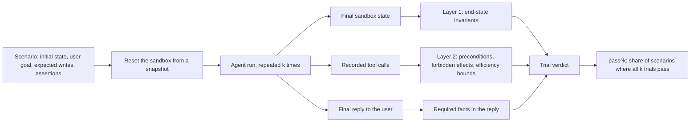

## Problem

A tool-using agent ends with a sentence such as "I canceled order #42 and issued the refund". A grader that reads that sentence cannot see what happened in the environment. Four outcomes share the same prose:

- The agent did not make the API call.
- The agent canceled the wrong order.
- The agent canceled the correct order, but without the confirmation that the policy demands.
- The agent succeeded in one run of five.

The two usual fixes also fail. Exact trajectory matching compares the tool calls with one reference run, and it fails each other valid path. [OSWorld](https://arxiv.org/abs/2404.07972) names this defect of earlier benchmarks: their "non-execution-based evaluation assumes a single solution for each task and wrongfully penalizes alternative correct solutions". One run hides the variance. [tau-bench](https://arxiv.org/abs/2406.12045) adds that "the trajectory can be extremely diverse for the same task, and success criteria are multi-faceted".

## Solution

Grade what the environment shows. Add the policy checks that the end state cannot show. Then repeat.

**Layer 1: end-state invariants.** After the run, compare the sandbox with the expected postconditions: the changed database rows or their hashes, the created files and their content, the API write ledger. The comparison ignores the prose of the agent. tau-bench "compares the database state at the end of a conversation with the annotated goal state". Its reward is 1 only if the final database is identical to the expected outcome, and if the replies to the user contain the required facts. OSWorld does the same on a desktop: getter functions extract the key files and values from the final state, and evaluator functions assess them.

The comparison stays simple only if the task has one legal outcome. tau-bench writes each instruction "in a way that guarantees only one possible outcome under the domain policy". When a task permits several outcomes, list the accepted end states.

**Layer 2: trajectory and policy assertions.** Some failures leave no trace in the end state. tau-bench says of its own reward that it is "a necessary but not sufficient condition for a successful episode", because "the agent might issue the return without explicit user confirmation, which violates the policy". Close that gap with predicates on the recorded tool calls:

- **Preconditions:** `confirm_with_user` occurs before `cancel_order`.
- **Forbidden side effects:** no write to a table outside the scope of the task.
- **Efficiency bounds:** at most N tool calls, and no repeated identical call.

Assert properties of the path, and not one exact path. Write the order as a requirement only when the policy mandates the order.

**Layer 3: `pass^k` reliability.** Reset the sandbox. Run the scenario at least `k` times. `pass^k` is "the chance that all k i.i.d. task trials are successful, averaged across tasks". With `n` trials and `c` successes, the estimate is `C(c, k) / C(n, k)`. `pass^1` is the average success rate. It hides the inconsistency that `pass^k` shows. The best agent in tau-bench had a success rate above 60% on retail, and its pass^8 on retail dropped below 25%.



```pseudo
def evaluate(scenario, trials=K):                        # K: at least the k in pass^k
    require evaluate_no_run(scenario) == FAIL            # control: an empty run must not pass
    outcomes = []
    for _ in range(trials):
        env.reset(snapshot=scenario.initial_state)       # the same start state for each trial
        run = agent.run(env, user=simulate_user(scenario.goal))
        r_state  = env.writes() == scenario.expected_writes        # layer 1: end-state invariants
        r_policy = all(a.check(run.tool_calls) for a in scenario.assertions)  # layer 2
        r_reply  = all(fact in run.final_reply for fact in scenario.required_facts)
        outcomes.append(r_state and r_policy and r_reply)
    c = sum(outcomes)                                    # successful trials
    return pass_k(c, trials, k), runs_for_triage(outcomes)

def pass_k(c, n, k):                                     # unbiased estimate from n trials
    return comb(c, k) / comb(n, k)                       # 1.0 only when all n trials pass
```

## Evidence

- **Evidence Grade:** `high` (two benchmark papers with open-source harnesses and reported human baselines; the sources support the end-state layer and the reliability metric, and they describe the gap that the assertion layer closes)
- **Most Valuable Findings:**
  - In tau-bench, gpt-4o with function calling reached a pass^1 of 61.2% on retail and 35.2% on airline (average 48.2%). The same agent was not consistent: its pass^8 on retail dropped below 25%. The leaderboard in the repository shows the same decay for gpt-4o on retail: 0.604 at pass^1, 0.491 at pass^2, 0.430 at pass^3, and 0.383 at pass^4.
  - The end state alone does not show each failure. tau-bench calls its reward "a necessary but not sufficient condition for a successful episode". In the failure analysis, 25% of the 36 agent failures were wrong decisions that occurred because the agent did not follow a domain rule. In the ablation table of the paper, gpt-4o fell from 33.2% to 10.8% on airline when the policy was removed from the prompt.
  - OSWorld has 369 tasks. Each task has an initial state setup and a custom execution-based evaluation script, and the benchmark has 134 unique evaluation functions. Different persons examined each example "from the perspective of alignment with the instruction and correctness under different solutions". The humans completed more than 72.36% of the tasks, and the best model 12.24%.
  - The checkers cost work. OSWorld reports "approximately 2 man-hours" for the evaluation of one example and its examination. tau-bench reports about 200 dollars for one trial of each retail task, with gpt-4o as the agent and as the user.
- **Unverified / Unclear:** Neither source scores trajectory assertions as a metric on top of the end state. tau-bench describes the gap and ships an error identification tool that uses a model and "may lead to inaccurate error identifications". No source measures how state that trials share changes pass^k. The README of the tau-bench repository states that its tasks are outdated and points to a successor benchmark. Thus results from the paper and results from that repository are not comparable.

## How to use it

1. **Make the environment inspectable and resettable.** Keep the mutable state in a sandbox: a seeded database, a file tree, an API write ledger. Give each trial its own instance, or a restore from a snapshot. OSWorld uses a virtual machine snapshot that "can be restored to this state at any time".
2. **Write the scenario as data.** Record the initial state, the goal for the user simulator, the expected writes, the facts that the reply must contain, and the assertions.
3. **Give each task one legal outcome.** Write the goal so that the policy and the goal permit one end state. Then a comparison of the state is sufficient, and no person needs to judge the result. If several end states are valid, list them.
4. **Grade the end state with a comparison.** Compare the write ledger or the state hash with the expected result. Do not parse the reply of the agent to learn the outcome.
5. **Assert properties of the path.** Write the preconditions, the forbidden side effects, and the efficiency bounds as predicates on the tool-call log. Examine each assertion against more than one valid trajectory before you trust it. At runtime, a [Policy-Gated Tool Proxy](policy-gated-tool-proxy.md) can enforce the same policy.
6. **Add controls for the checker.** An empty run must fail the scenario, and a reference run must pass it. A checker that passes both is not a checker.
7. **Repeat, and report `pass^k`.** Reset the sandbox for each trial. Run each scenario at least `k` times. Report `pass^1` for diagnosis. Report `pass^k` for the release decision.
8. **Make the user simulator imperfect.** Sample the user at a temperature above zero (tau-bench uses 1.0 for the user and 0.0 for the agent). Include goals with a typo, a hidden constraint, and a change of mind. Count the faults of the simulator separately from the faults of the agent.
9. **Keep the evidence with the verdict.** Store the tool-call log, the state diff, and the reply, so that a failed trial is fast to triage (see [Evidence-Layered Evaluation for Interactive Agents](evidence-layered-evaluation-for-interactive-agents.md)). Let each production incident become a scenario ([Incident-to-Eval Synthesis](incident-to-eval-synthesis.md)).
10. **Run it in CI with mocks.** [Workflow Evals with Mocked Tools](workflow-evals-with-mocked-tools.md) supplies the harness that runs the scenarios on each change.

## Trade-offs

**Pros:**

- The verdict shows what the agent did, and not what the agent said.
- Each valid path passes, so the grader does not punish a different correct solution.
- `pass^k` shows an inconsistency before the users meet it.
- A comparison of states needs no judge model. It is fast, exact, and the same on each run.

**Cons:**

- Each scenario needs an inspectable sandbox and a checker that a person writes.
- Repeated trials multiply the cost of the evaluation.
- A task with one legal outcome needs careful annotation.
- A state comparison does not show each policy violation. The assertions for those need more work.

### Failure modes

- **Over-constrained trajectory matching.** An agent that reaches the correct end state by a different order of tool calls fails. The cause is a comparison with one reference sequence, or an assertion copied from one run. Assert invariants and the limits of the policy. Examine each assertion against several correct solutions, as OSWorld does. Fix the order only when the policy mandates the order.
- **Dirty environments.** The second trial passes because the first trial already created the file, or because the database still contains the canceled order. `pass^k` then measures the leftovers and not the agent. The cause is state that the trials share. Reset from a snapshot or a seed for each trial. Give each trial its own instance.
- **Unrealistic user simulators.** The score is high, and the users then report failures that the evaluation never showed. The cause is a simulator that gives each fact at once and never changes its mind. In tau-bench, 4 of 40 failed runs came from a typo or an ambiguity in the instruction of the user. Sample the simulator at a temperature above zero. Add goals with missing facts and with corrections. Count the faults of the simulator on their own.
- **Only `pass@1`.** The agent ships with a high single-run success rate, and the users meet failures when they repeat a task. The cause is one trial for each scenario, which hides the variance between runs. The best agent in tau-bench had a success rate above 60% on retail and a pass^8 below 25%. Run repeated trials. Set a `pass^k` target for the release.

## References

- [τ-bench: A Benchmark for Tool-Agent-User Interaction in Real-World Domains](https://arxiv.org/abs/2406.12045) (Yao et al., 2024): end-state database comparison and the `pass^k` reliability metric.
- [tau-bench](https://github.com/sierra-research/tau-bench): the open-source benchmark and evaluation harness.
- [OSWorld: Benchmarking Multimodal Agents for Open-Ended Tasks in Real Computer Environments](https://arxiv.org/abs/2404.07972) (Xie et al., 2024): execution-based verification of the state of a real desktop environment.
- Related: [Workflow Evals with Mocked Tools](workflow-evals-with-mocked-tools.md) (the CI harness that runs the scenarios), [Deterministic Grader in the Loop](deterministic-grader-in-the-loop.md) (a state comparison is a deterministic grader), [Evidence-Layered Evaluation for Interactive Agents](evidence-layered-evaluation-for-interactive-agents.md) (keeps the evidence that explains a failed trial), [Incident-to-Eval Synthesis](incident-to-eval-synthesis.md) (turns a production incident into a scenario)
