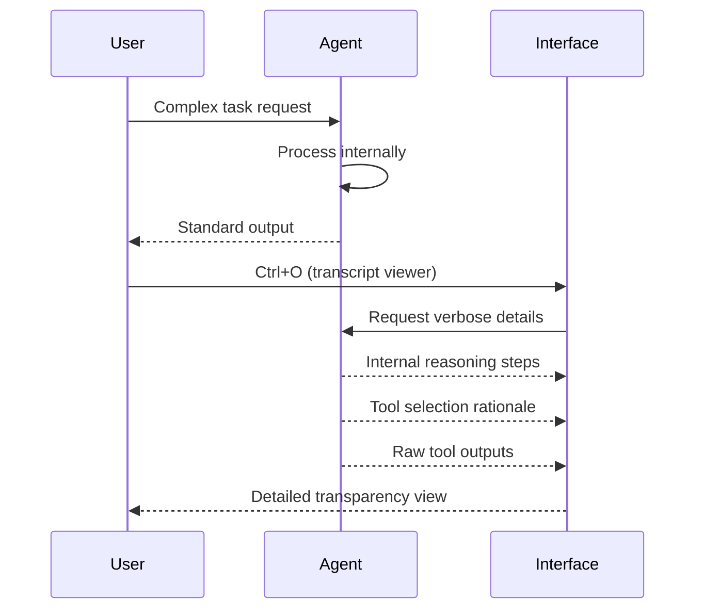

## Problem

AI agents, especially those using complex models or multiple tools, can sometimes behave like "black boxes." Users may not understand why an agent made a particular decision, chose a specific tool, or generated a certain output. This lack of transparency can hinder debugging, trust, and the ability to effectively guide the agent.

## Solution

Implement a feature that allows users to inspect the agent's internal "thought process" or reasoning steps on demand. In Claude Code, `Ctrl+O` toggles the transcript viewer, which shows detailed tool usage and execution per assistant message; the `--verbose` flag (and the matching `verbose` setting) raises output detail for a session.

When activated, the verbose output might reveal:

-   The agent's interpretation of the user's prompt.
-   Alternative actions or tools it considered.
-   The specific tool(s) it selected and why (if available).
-   Intermediate steps or sub-tasks it performed.
-   Confidence scores or internal states, where a harness exposes them (Claude Code does not).
-   Raw outputs from tools before they are processed or summarized.

This transparency helps users understand the agent's decision-making process, identify issues if the agent is stuck or producing incorrect results, and learn how to prompt more effectively.

**Faithfulness caveat:** displayed reasoning is not guaranteed to be what actually drove the answer. Anthropic finds that reasoning models often do not verbalize their real reasoning ([Reasoning models don't say they think](https://www.anthropic.com/research/reasoning-models-dont-say-they-think)), and OpenAI reports that models under monitoring can learn to obfuscate ([arXiv:2503.11926](https://arxiv.org/abs/2503.11926)). Use verbose views to debug behavior; do not treat them as proof of the model's intent.

**Distinct from** [Chain-of-Thought Monitoring & Interruption](chain-of-thought-monitoring-interruption.md), which watches the reasoning stream continuously for safety: this pattern is a human opening the view on demand to debug or learn.

## Example (transparency activation)

## How to use it

- Debugging agents that produce incorrect or unexpected outputs
- Learning how to prompt more effectively by studying agent reasoning patterns
- Building trust in high-stakes scenarios where understanding "why" matters
- Complementing human-in-the-loop approval workflows with transparency

## Trade-offs

* **Pros:** Enables debugging of unexpected agent behavior, supports prompt engineering, and builds trust through explainability.
* **Cons:** Requires careful handling of sensitive information (system prompts, credentials); displayed reasoning can be unfaithful to the model's actual computation (see the caveat above), so it can mislead as well as explain.

## References

-   [Claude Code interactive mode](https://code.claude.com/docs/en/interactive-mode) — `Ctrl+O` toggles the transcript viewer (detailed tool usage and execution); `Ctrl+R` is reverse command history search.
-   [Reasoning models don't say they think](https://www.anthropic.com/research/reasoning-models-dont-say-they-think) — Anthropic (2025): displayed chain of thought often omits the real reasoning.
-   [Monitoring Reasoning Models for Misbehavior and the Risks of Promoting Obfuscation](https://arxiv.org/abs/2503.11926) — OpenAI (2025): monitoring reasoning can reward obfuscation.
-   Wei et al. (2022). "Chain-of-Thought Prompting Elicits Reasoning in Large Language Models." *NeurIPS*. https://arxiv.org/abs/2201.11903
-   Mohseni et al. (2021). "HCI Guidelines for Explainable AI." *arXiv:2108.05206*. https://arxiv.org/abs/2108.05206

[Source](https://www.nibzard.com/claude-code)
