## Problem

When agents can modify policy/constitution text, safety regressions can be introduced gradually and go unnoticed. Without versioning, signatures, and policy review gates, teams cannot prove who changed what, why it changed, or whether critical safeguards were weakened.

## Solution

Store the constitution in a **version-controlled, signed repository**:

- YAML/TOML rules live in Git for automated rule enforcement; natural language principles guide LLM-based evaluation.
- Each commit is signed (e.g., Sigstore); CI runs automated policy checks.
- Only commits signed by approved reviewers or automated tests are merged.
- The agent can *propose* changes, but a gatekeeper merges them.
- Use semantic versioning: MAJOR for core safety principle changes, MINOR for additions, PATCH for clarifications.

Combine policy-as-code with release discipline: every constitutional change is diffable, reviewable, and test-gated before activation. This gives governance history, rollback capability, and auditable control over alignment policy evolution.

```mermaid
flowchart LR
    A["Agent or human proposes a change"] --> PR["Pull request with a signed commit"]
    PR --> CI["CI policy checks"]
    CI -->|"fail"| PR
    CI -->|"pass"| RV["Approved reviewer signs off"]
    RV --> MG["Signed merge to main"]
    MG --> V["Immutable release tag, semver"]
    V --> RT["Runtime loads the pinned tag only"]
    RT --> AUD["Episode records the constitution version"]
```



```pseudo
def propose(actor, change):
    commit = git.commit(change, sign_with=actor.key)        # an agent key, never a reviewer key
    return open_pull_request(commit)

def merge(pr):
    require_signature(pr.head, allowed=REVIEWER_KEYS)        # agent keys are not in this set
    require(checks_passed(pr, ["rule-lint", "critical-rule-diff", "policy-eval"]))
    git.merge(pr, verify_signatures=True)
    return tag(next_version(pr, bump=classify(change)))      # MAJOR, MINOR, or PATCH

def load_constitution(episode):
    pinned = PINNED_VERSION                   # a tag or commit hash, never a branch name
    return git.show(pinned, PATH)             # read-only: the runtime cannot write to the repo
```

## Evidence

- As of October 2026, no public writeup describes this full mechanism (signed constitution repository, CI policy gates, semver for constitutions). The pattern composes practices that are individually established.
- OpenAI publishes the Model Spec as dated, versioned releases with a public changelog — versioned publication of model-behavior policy in practice.
- Signed commits and merge-time signature enforcement are standard Git practice, documented in Pro Git.

## How to use it

- Require `git commit -S` or similar.
- Run diff-based linting to flag deletions of critical rules.
- Expose constitution `HEAD` as read-only context in every agent episode.

To make the gate hold in practice:

- Pin which commit is `HEAD` for a deployment (a tag or commit hash, not a branch that keeps moving), and record that digest in every episode or trace.
- Keep merge checks deterministic. An LLM-based policy critique can advise reviewers, but a flaky blocking check gets bypassed.
- Exclude agent signing keys from merge authorization, and require a human signature for MAJOR changes.
- Roll back by moving the pin. Rolling back the text does not undo actions already taken under the old version.

Related patterns: [Canary Rollout and Automatic Rollback for Agent Policy Changes](canary-rollout-and-automatic-rollback-for-agent-policy-changes.md) governs staged exposure after a policy change ships; this pattern governs what is allowed to merge. [Cryptographic Governance Audit Trail](cryptographic-governance-audit-trail.md) signs the actions taken under a given policy version.

### Failure modes

- **Policy that never goes through Git.** The signed repository governs one file, but the runtime assembles its prompt from other sources too: a feature flag, an environment variable, a config panel, or a hotfix pushed straight to the host. [Layered Configuration Context](layered-configuration-context.md) is one common route. That text carries policy with no history and no signature. Inventory every input to the rendered prompt, route all of them through the repository, and have CI assert that the deployed prompt matches the pinned version.
- **A floating version.** The runtime follows `main` or "latest", so a merge changes production behavior instantly, with no release step, no rollback target, and no record of which version an episode used. Pin a tag or digest per deployment and promote by moving the pin.
- **Self-approval.** The agent proposes the change and also holds a reviewer key, or the reviewer is an automation that approves whatever CI approves. Agent keys must be structurally excluded from merge authorization, and the gatekeeper has to sit outside the agent's control.
- **A weakened rule hidden in a small diff.** A rule disappears through a rename and a "PATCH: wording" commit, a reformat, or a move from YAML (enforced) into prose (advisory). Lint the diff on a normalized syntax tree rather than raw text, keep a protected list of rule ids that cannot be removed without a MAJOR bump, and test that each critical rule id still resolves in the pinned build.

## Trade-offs

* **Pros:** Strong auditability, safer policy evolution, and fast rollback of bad constitutional changes.
* **Cons:** Slower policy iteration and extra operational burden for signing, review, and CI checks.

## References

- [OpenAI Model Spec](https://model-spec.openai.com/) — primary source for versioned behavior policy: dated public releases with a changelog maintained in the [openai/model_spec](https://github.com/openai/model_spec) repository. It covers publication and versioning of a behavior spec, not signed-commit repo governance of a runtime constitution.
- [Pro Git, "Signing Your Work"](https://git-scm.com/book/en/v2/Git-Tools-Signing-Your-Work) — the mechanism this pattern relies on: GPG-signed commits, signature verification in history, and merge-time enforcement with `git merge --verify-signatures`.
- Anthropic, *Constitutional AI: Harmlessness from AI Feedback* ([arXiv:2212.08073](https://arxiv.org/abs/2212.08073), 2022) — constitution-guided training; the "constitution" concept this pattern governs.
- [Hiveism, "A path towards solving AI alignment"](https://hiveism.substack.com/p/a-path-towards-solving-ai-alignment) — contrast, not basis: the article proposes an alignment loop in which agents deliberate and rewrite their own constitution, and argues a company "would have no way to influence the direction the AI takes." It contains no Git, signing, reviewer, or CI content. The earlier front-matter attribution to this essay was wrong and is removed.
