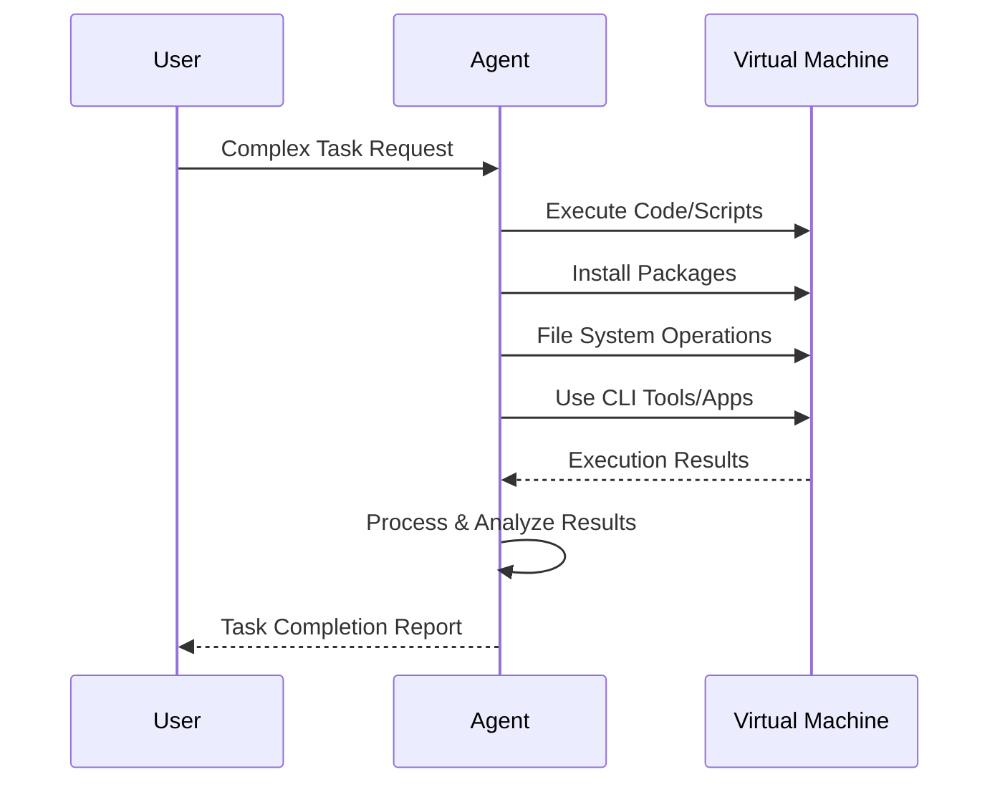

## Problem

AI agents need to perform complex tasks beyond simple code generation or text manipulation. They require the ability to interact with a full computer environment to execute code, manage system resources, install software, and operate various applications.

## Solution

Equip the AI agent with access to a dedicated virtual machine (VM) environment. The agent is trained or designed to understand how to operate within this VM, treating it as its direct workspace. This allows the agent to:

- Execute arbitrary code and scripts.
- Install and manage software packages.
- Read from and write to the file system.
- Utilize other command-line tools and applications available within the VM.

This pattern transforms the agent from a specialized tool into a more general-purpose digital operator.

Common implementation approaches include:

- **Full virtual machines** (EC2, GCP) - Maximum isolation, higher overhead
- **MicroVMs** (Firecracker, Modal, E2B) - Balanced isolation with fast startup
- **Container isolation** (Docker, Kubernetes) - Faster startup, shared kernel risk
- **Tool-mediated execution** - Minimal overhead, capability-scoped

## Example (flow)

## How to use it

- Pick the isolation level to match the workload: full VMs for untrusted or long-lived work, microVMs or containers for fast per-task sandboxes.
- Give the agent a scoped entry point (shell, file API, or screen) rather than raw host access, and snapshot or reset the filesystem between sessions.
- Budget for cold starts: keep warm pools or reuse a session for multi-step tasks instead of provisioning per call.
- Log everything that runs inside the machine so results and failures can be audited after the fact.
- Enforce hard execution limits (CPU, wall-clock, network egress) outside the VM, not by trusting the agent to stop.

## Trade-offs

* **Pros:** Gives the agent a full general-purpose environment (code execution, package installs, CLI tools) with strong isolation from the host; failures stay inside the disposable machine.
* **Cons:** Cold-start latency and per-hour compute cost; environment upkeep (images, dependencies); screen- or shell-mediated operation is slower and more error-prone than purpose-built tools.

## References

- Amjad Masad (Replit), speaking at a Village Global event: "People think of computer use as something like an operator, but actually it is more like you give the model a virtual machine, and it knows how to execute code on it, install packages, write scripts, use apps, do as much as possible with the computer." Quoted as recounted in [How AI Agents Are Reshaping Creation](https://www.nibzard.com/silent-revolution), a secondary summary that states over 90% of its text was AI-generated; Amjad Masad: https://x.com/amasad

- Anthropic computer use tool documentation - production API for agents that operate a computer (screenshots, cursor, keyboard): https://platform.claude.com/docs/en/agents-and-tools/tool-use/computer-use-tool

- E2B - sandbox microVM provider for running agent-generated code: https://e2b.dev

- Modal - sandboxed cloud containers for agent code execution: https://modal.com

- Beurer-Kellner et al. (2025). "Design Patterns for Securing LLM Agents." arXiv:2506.08837 - Comprehensive framework for secure LLM agent execution including Action Selector and Code-Then-Execute patterns.

- Yao et al. (2022). "ReAct: Synergizing Reasoning and Acting in Language Models." arXiv:2210.03629 - Foundational reasoning-acting paradigm (Thought → Action → Observation).
