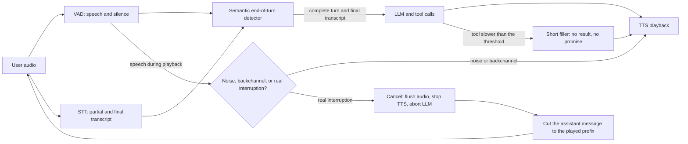

## Problem

A chat loop gets turn-taking for free. The user submits a message, and the agent replies after that. Live audio has no submit event. From a sound stream, the agent must decide when the user has finished and when the user has cut in.

[Chain-of-Thought Monitoring & Interruption](chain-of-thought-monitoring-interruption.md) gives the user a stop button for reasoning that the user can read. A voice channel has no button. The user speaks, and the agent must recognize that speech as a stop signal.

The common port of a chat loop to audio uses one voice activity detector (VAD) and a silence timer. It fails in three ways:

- **It cuts users off.** A pause after "I'd like to book..." starts the reply, and the agent talks over the rest of the sentence.
- **It stops for anything.** A cough, a door, or a listener's "uh-huh" counts as speech, so the agent stops in the middle of an answer.
- **It answers words that nobody heard.** After the agent is cut off, its complete reply stays in the conversation history. The next reply assumes that the user heard all of it.

A fourth defect appears when the agent calls a tool. Speech stops, the caller hears silence, and many callers start to speak again or hang up.

## Solution

Run four control loops in one pipeline. Each loop corrects one defect. The loops share three signals: the audio playout clock, the transcript, and the cancellation state.

1. **Two-stage endpointing.** A fast acoustic VAD finds speech and silence. A semantic end-of-turn detector then reads the partial transcript and the acoustic properties of the speech. It decides whether the thought is complete or the speaker paused in the middle of a clause. The turn ends when the detector reports a complete turn and the final transcript is available. A maximum delay closes the turn when the detector does not decide.
2. **Adaptive barge-in and pipeline flush.** Speech that arrives during playback goes through a second decision: noise or backchannel, or a real interruption. A real interruption emits a high-priority cancel signal. The signal stops TTS synthesis, clears the output audio buffers, and aborts LLM generation and each speculative reply.
3. **Playback-offset transcript reconciliation.** The pipeline tracks how much of the reply reached the user's speaker when the interruption arrived. It uses the timestamps of the TTS segments to map that duration to a text offset. Then it cuts the assistant message in the conversation history down to that spoken prefix.
4. **Tool-call latency masking.** When a tool call is slower than a threshold, the agent says one short line, such as "Let me check that for you", and runs the tool asynchronously. The line reports no result and makes no promise.

The start and the end of a turn need opposite treatment. A barge-in must be fast, so its cancel signal outranks the frames that wait in the queue. The end of a turn must be correct, so it waits for the final transcript.



```pseudo
on_user_speech_started():                    # from VAD: speech, noise, or echo
    if not agent.is_speaking(): return       # a normal turn start
    if not real_interruption(audio, interim_transcript):
        return                               # noise, backchannel, or echo
    agent.interrupt()                        # outranks queued frames, aborts the LLM
    played_ms = player.playout_position()    # audio that reached the speaker
    history.replace(agent.reply, spoken_prefix(agent.reply, played_ms))

async on_silence(interim_transcript, elapsed):
    complete = turn_detector.complete(interim_transcript)
    if not complete and elapsed < max_delay: return   # the speaker may continue
    reply = await run_llm_and_tools(final_transcript())
    agent.say(reply)

async run_llm_and_tools(text):
    call = start_tool_call(text)             # receives the cancellation signal
    done = await race(call, timer(filler_delay))
    if done is timer:                        # the tool is slow: mask the silence
        say_cached("Let me check that for you.")      # no facts, no promises
    return await call
```

## Evidence

- **Evidence Grade:** `high` (two independent open-source frameworks ship these mechanisms and document the failure modes)
- **Most Valuable Findings:**
  - The turn detector of LiveKit "Predicts end of turn from both the meaning of speech and its acoustic properties, on top of VAD". Its VAD-only mode is for "minimal latency" or for a language that the model does not cover.
  - LiveKit describes the history fix directly: "When interrupted, the agent stops speaking and automatically truncates its conversation history to include only the portion of the speech that the user heard before interruption". In its source, each TTS audio frame carries timed text, and an interrupted segment reports its playback position. The text that stays is "The text that actually reached the user, accounting for interruptions".
  - The adaptive interruption mode of LiveKit "uses an audio model to distinguish real interruptions from backchannel acknowledgments". Its tuning guide lists "Agent cuts users off mid-thought" and "Agent is interrupted by short acknowledgments" as common symptoms.
  - Pipecat processes an `InterruptionFrame` as a system frame. System frames outrank data and control frames in the queue of each processor, and the interruption cancels the current tasks of that processor.
  - A tool is not stopped by the interruption in LiveKit: "A tool continues running in the background until it returns". For work that "takes more than a few seconds", its guide recommends an async tool, so that "the agent can keep talking and send progress updates while the tool runs".
  - For the wait, LiveKit shows "a pre-synthesized hold message" that "avoids TTS latency during tool execution". Pipecat ships the remark for a long wait as an optional extension, `WaitReassuranceLLMExtension`. Its default interval is 10 seconds of quiet, and it instructs the model: "Never report a result or a finding, never say the work is done, and ask no questions and make no offers or promises".
- **Unverified / Unclear:** No source measures the effect of the hold message or gives a threshold for it. The interval of 10 seconds of Pipecat is the quiet time before a progress remark, not before the first acknowledgement. No source gives accuracy figures for the turn and interruption models. LiveKit licenses its turn detection models under a separate model license, and self-hosted use of adaptive mode counts toward a monthly development allowance.

## How to use it

1. **Start from the framework defaults.** LiveKit enables the turn detector by default, with an endpointing minimum delay of 0.5 seconds and a maximum of 3.0 seconds. Tune from measurements, not by feel.
2. **Keep two detectors.** Use VAD for barge-in, because it is fast. Use the semantic detector for end of turn, because it must be correct. Do not use one model for both jobs.
3. **Gate the barge-in.** Require a minimum speech duration or a minimum number of transcribed words before an interruption counts. Resume the reply from the cut point when an interruption was false.
4. **Flush on each interruption.** Stop TTS, clear the audio buffers, and abort LLM generation, speculative replies, and the speech that waits in the queue.
5. **Reconcile the history in code.** Cut the assistant message to the spoken prefix before the next LLM call. Do not ask the LLM to detect the cut.
6. **Mask tool latency.** Run a slow tool asynchronously, so that the agent can keep talking. Set the threshold from measurements of your tools. Keep a pre-synthesized hold message ready, so that it plays without TTS latency and stops when the tool returns. A remark while the user waits must not report a result, say that the work is done, or make a promise.
7. **Classify each tool.** A read-only lookup can be interrupted, and its result stays in the history. A write needs a cancellation check before its commit step, or it must be uninterruptible. Tell the caller when a step cannot be cancelled.
8. **Watch three metrics.** Count the cut-off user turns, the false interruptions, and the time from barge-in to silence.
9. **Compose with the neighbors.** [Agent Circuit Breaker](agent-circuit-breaker.md) stops repeated calls to a dead tool, which cause repeated dead air. [Spectrum of Control / Blended Initiative](spectrum-of-control-blended-initiative.md) applies to speech also: mark an utterance uninterruptible when it must play in full. For the reasoning that continues after a barge-in, see [Dual-Speed Realtime Architecture (Talker-Reasoner)](dual-speed-talker-reasoner-architecture.md).

## Trade-offs

**Pros:**

- Users can correct the agent in the middle of a sentence, not after the reply.
- The conversation history agrees with what the user heard, so later replies stay coherent.
- A slow tool no longer sounds like a dropped call.
- Each loop has its own metric, so a team can tune one loop without the others.

**Cons:**

- End-of-turn accuracy costs latency: a longer endpointing delay gives fewer cut-offs and slower replies.
- The pipeline runs more models (VAD, turn detector, interruption classifier), and some of them have separate licenses.
- The quality depends on the client. Echo cancellation runs in the client, and telephony has no browser to do it.
- Playout tracking, cancellation, and history truncation must hold in each frame processor, which makes the pipeline harder to change.

### Failure modes

- **The agent interrupts itself.** The agent stops speaking a moment after it starts, and nobody else is in the room. The cause is its own TTS output: the microphone picks up the speaker, and the echo reaches the VAD as user speech when the echo cancellation of the client fails or when a caller uses a speakerphone. Cancel the echo before the audio leaves the client, require transcribed words before an interruption counts, and resume the reply after a false interruption.
- **Phantom context.** The agent says "as I mentioned earlier" about words that it never spoke, or it never returns to the cut-off part of an answer. The cause is the complete reply in the conversation history while the user heard a prefix of it. Truncate the assistant message to the played prefix in code, at the moment of the interruption.
- **A backchannel stops the agent.** The user says "uh-huh" to show that they follow, and the agent stops. The cause is a VAD-only trigger that counts each speech as an interruption. Use adaptive interruption detection, set a minimum word count or speech duration, and resume after a false interruption.
- **An orphaned tool call.** The user says "actually, never mind, do not book it", and the booking completes. The cause is a tool that continues after the interruption, because an interruption of the agent does not cancel the work. Pass a cancellation signal into each tool, test it before the commit step, and make a write that cannot be rolled back uninterruptible.

## References

- [Pipecat](https://github.com/pipecat-ai/pipecat): open-source Python framework for real-time voice and multimodal agents, with interruption frames, VAD, and end-of-turn analyzers.
- [LiveKit Agents](https://github.com/livekit/agents): open-source framework for realtime voice AI agents, with semantic turn detection.
- [LiveKit Agents documentation](https://docs.livekit.io/agents/): turn detection, endpointing, interruptions, and tool-call handling.
- Related: [Chain-of-Thought Monitoring & Interruption](chain-of-thought-monitoring-interruption.md) (the stop signal on the text side), [Spectrum of Control / Blended Initiative](spectrum-of-control-blended-initiative.md) (selects what the user can interrupt), [Agent Circuit Breaker](agent-circuit-breaker.md) (stops repeated calls to a dead tool), [Dual-Speed Realtime Architecture (Talker-Reasoner)](dual-speed-talker-reasoner-architecture.md) (the background reasoning that a barge-in must cancel)
